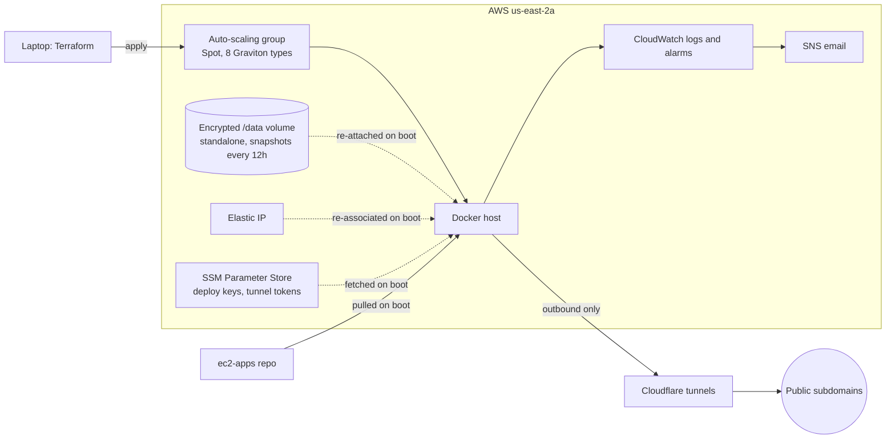

# Self-healing EC2 host

Can one cheap Spot instance run a stack of small apps with no hands on it? Yes: a Terraform-managed Docker
host that is killed and replaced by AWS routinely, comes back with the same IP and data each time, and runs
seven apps behind Cloudflare tunnels.

## The problem

Spot capacity is cheap because AWS can take it back on two minutes' notice. Running databases, scrapers and
bots on it means every interruption has to lose nothing and need no one to log in. One constraint makes this harder: the apps keep SQLite files on a block
volume, and a volume lives in a single availability zone, so the host cannot escape a capacity shortage by
moving zones.

## Data

Operational data only: the auto-scaling group's activity log, CloudWatch group metrics (enabled August 2026,
kept 15 months), boot logs, and Spot prices.

## Approach

- **Two repos, decoupled.** ec2-infra (Terraform, run from the laptop) provisions a generic Docker host and
  knows nothing about apps. ec2-apps (compose file, app manifest, systemd timers) is pulled on every boot, so
  adding an app never touches the infrastructure.
- **Boot rebuilds everything.** A user-data script installs Docker and tooling, re-attaches the data volume
  (retrying for up to three minutes while the old instance lets go), re-associates the Elastic IP, fetches
  deploy keys from Parameter Store, pulls each app repo and starts the containers.
- **Interruption handling.** A service watches the instance metadata for the two-minute warning, then stops
  the containers and flushes writes to disk.
- **Capacity.** One availability zone, but eight ARM instance types under AWS's price-capacity-optimized
  strategy: the cheapest type with spare capacity wins, and pricier types are only used when the cheap pools
  run dry.
- **Security.** No inbound ports, no SSH and no key pairs; shell access through SSM Session Manager only,
  IMDSv2 enforced, every custom IAM policy scoped to specific resources. Public apps reach the internet through
  outbound Cloudflare tunnels.
- **Cost controls.** The host scales to zero from 23:30 to 07:00 Eastern, and every scheduled job is timed to
  fall inside the waking window. An AWS Budget alarms at $20 a month.
- **AI on the host.** Apps call Claude and Titan embeddings on Bedrock through the instance role, with no API
  keys stored; Claude Code is installed on the host, signed in once, with its login kept on the data volume.

## Apps it runs

big-ten-jobs (scraper, feed and explorer), ask-ben (database, API, evaluation), wcc-pathfinder, a solar
dashboard and Discord bot, a journal dashboard, the workspace project-notes agent, and fantrax: 15 containers
and nine scheduled jobs.

## Results

- **Spot churn, measured.** 27 days of scaling activity in July and August 2026 showed 272 Spot interruptions
  and 456 launches that failed for lack of capacity, all in the host's zone. Interruptions clustered on
  weekday afternoons (peak 2pm Eastern, almost none after 6pm), and weekdays ran five to nine times worse than
  weekends.
- **The fix worked.** Widening the pool from five instance types to eight cut churn from 142 interruptions and
  197 failed launches in the 12 days before to 7 and 0 in the four days after. On the first apply, a host
  stranded by the shortage launched on one of the new types within seconds.
- **Short gaps.** From October 10 to November 9 the host dropped out 17 times during waking hours. In 15 of
  those the group was back in service within one 5-minute metric interval, and the other two within two
  intervals. Apps then need their boot and setup time on top, which the group metric does not see.
- **About $13 a month for the host.** Spot compute, the data volume and snapshots came to $14.25 in August,
  $13.58 in September and $12.32 in October. The whole AWS account, including the public IP charge and the
  apps' Bedrock and Transcribe use, ran $22.47, $20.28 and $17.99. The type dropped in the widening was the
  priciest and smallest in the pool, so the fix lowered the worst-case rate as well.
- Open question: time from replacement to apps serving, from the boot logs.

## Code

- [ec2-infra](https://github.com/bkoester/ec2-infra): Terraform, boot script, management scripts (private
  until cleaned up)
- [ec2-apps](https://github.com/bkoester/ec2-apps): compose file, app manifest, timers, secret-scanning hook
  (private until cleaned up)

## What I'd do differently

- Ignore Terraform plan files from the first commit. One was committed in April and carried a state snapshot
  until it was purged from history in November.
- Start with several instance types. The first version relied on a single Spot pool and churned whenever that
  pool ran dry.

## To resolve

- [x] Delete terraform/tfplan and purge it from history; ignore *.tfplan
- [x] Architecture diagram
- [x] Monthly bill and recovery time (Results)
- [ ] Boot-to-serving time from the boot logs
- [ ] Ben: check "What I'd do differently"
- [ ] Replace the default subnet ID in variables.tf with a required variable
- [ ] Ask GitHub Support to drop the cached refs for closed PRs #2 and #3, which still hold the old plan file
- [ ] Review ec2-apps for secrets; then make both repos public
- [ ] Consider publishing as a reusable template
